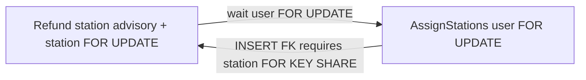
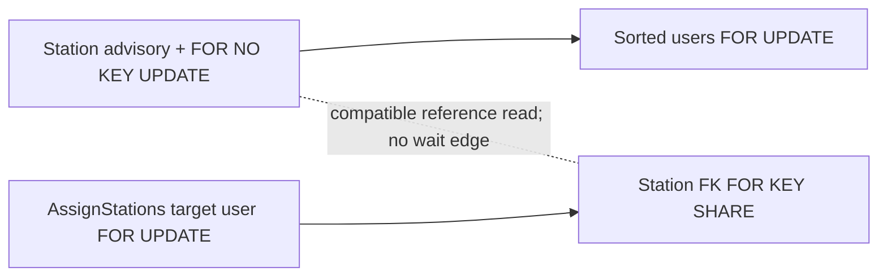

# P8B-B1A-01 — Refund / AssignStations deadlock remediation

Checkpoint cuối17/11/2026 (+07; reproduction bắt đầu16/11 UTC). **P8B-B1A-01 FIXED — B1a READY FOR INDEPENDENT REVIEW**, trong phạm vi kiểm chứng dưới đây. Đây không là B1a accepted, full Refund hoặc full MVP acceptance.

## Baseline và reproduction trước sửa

HEAD main de9b9288452f3c4e2b6703ed0ce641668ac8fc78; index rỗng,6 tracked modifications và1047 untracked tại checkpoint trước. Giữ migration0009/B0 overlays/8A conditional acceptance, không sửa historical evidence. Docker29.9.2/PGhealthy/pg_isready trước run, không runner cũ. Migration demo0002 không thay đổi. Original probe `tests/test_phase8b_lock_graph_probe.py` giữ assertions/bytes; source copy tại run04 và hashes tại run05/06 bảo vệ provenance.

Run `b1a_deadlock_before_20261116_06`: **1 Failed,exit1**, original probe; plugin opt-in `tests/phase8b_deadlock_capture.py` chỉ ghi error40P01 DETAIL/CONTEXT/SQL, không parameters/secrets. Server log trong `postgresql_deadlock.public.json` xác nhận cùng cycle, không suy từ503:

- Refund PID38937, transaction589358, giữ station advisory và station tuple FOR UPDATE; chờ user tuple (0,4) trong `SELECT users.id WHERE … FOR UPDATE`, ShareLock trên transaction589357 của PID38920.
- Assignment PID38920, transaction589357, giữ Technician user FOR UPDATE; `INSERT user_station_assignments(user_id,station_id)` cần RI FK parent station FOR KEY SHARE; chờ ShareLock transaction589358 của Refund.
- Server DETAIL ghi cả hai cạnh và cả hai SQL statements, CONTEXT xác nhận locking users. FK hidden lock không hiện nguyên dạng trong client INSERT SQL. Không có provider/custody effect. No partial mutation; protected fingerprint/case version1/UNKNOWN/oldfalse không đổi.



## Call graph / impacted callers — inventory trước sửa shared helper

`assets.station_lock` lấy advisory `assets:station:UUID` rồi station row; `workers.device.station_locks` dùng helper này rồi sorted users → swaps → compartments → pins. `refunds.lock_context` và `recovery.lock_context` thêm sorted participants (kể cả historical creators), sau resource locks mới lock Payment/Refund/exact sessions. Identity AssignStations giữ user trước DELETE/INSERT FK; UpdateUser giữ user rồi revoke sessions, logout giữ exact session, không lấy station. Không thay auth semantics hoặc bỏ các participant/session guards.

Direct callers (đã rg source):

| Module | Functions / boundary | Required regression |
|---|---|---|
| assets.py | station_lock; update_station; update_device; compartment_action | Phase2 station/device/compartment/availability and assignment |
| batteries.py | create/change battery placement/lifecycle | Phase3 custody/BMS |
| device.py | ingest/poll/verify command interlocks | Phase4 ordering/inbox/command |
| reservations.py | verification/lock_swap/reserve/cancel/expire | Phase5 QR/RFID/hold/ordering |
| payments.py | lock; callback/results/worker via lock | Phase6 intent/outbox/receipt/retry |
| workers/device.py | station_locks→process_one/timeout_station; swap advance | Device/P7 custody/deadline |
| recovery.py; recovery_inspection.py | lock_context; observations/tasks, indirect authorization/handover/settlement/successor/closure | Phase8A security/IA01/audit/settlement/fences |
| refunds.py | request/reconcile lock_context | B1a original probe/API/refusal/session/assignment concurrency |

Exact source line inventory và hashes sẽ ghi ở evidence cuối; line numbers có thể dịch sau comment. Không sửa callers riêng lẻ hoặc runtime isolation.

## Minimal repair design

Đổi **chỉ station tuple mode** trong shared `assets.station_lock` thành `FOR NO KEY UPDATE`, giữ nguyên station advisory trước đó và mọi sorted user/resource/session locks. PostgreSQL NO KEY UPDATE vẫn exclusive với NO KEY UPDATE, FOR UPDATE, station UPDATE/key-change/DELETE; FK FOR KEY SHARE tương thích. Vì vậy workflow writers vẫn serialize như trước, FK reference không cần đợi station writer rồi tạo cạnh ngược. `get_row(lock=True)` cho users/resources/sessions giữ FOR UPDATE.

Station API chỉ sửa name/address/state; không sửa id/code, không DELETE station. Những thao tác key-changing/deletion ở SQL vẫn bị PostgreSQL giữ khóa xung đột; không đổi isolation hoặc cho phép state writers chạy song song. AssignStations vẫn linearize qua user FOR UPDATE: assignment thắng thì commit trước khi Refund/Recovery lấy user và re-read quyền; Refund/Recovery lấy user trước thì assignment đợi tới commit/rollback. Không bắt40P01/retry để che graph, không network/human wait trong production locks. Không đổi contract/RBAC/deadlines/fences/eligibility/certificate/migration.

## Verification plan / stop conditions

1. Original probe chạy lại nguyên vẹn, cả chiều assignment-first và reverse/refund-first có deterministic PG wait evidence.
2. Native FK KEY SHARE compatibility, second station mutex waiter, row-only station non-key UPDATE waiter và key-change/DELETE conflict; không bỏ required row serialization.
3. Full HTTP AssignStations vs Refund hai ordering, logout/revoke, same/different keys, session expiry và evidence freshness native clock qua lock wait; Recovery/Payment/Device competitors.
4. Chạy lại192 targeted/affected tests và thêm direct shared-helper callers; static77/OpenAPI/schema/grants, source hashes/diff check.
5. Check no intent/certificate/provider effect, Payment/custody/3holds, case/version/audit/replay/rollback. Positive refund/provider E2E vẫn NOT RUN (B1b/B2/B3 chưa triển khai).

Nếu Major mới thì giữ failing probe/evidence và dừng dependent branch. Không stage/commit/push hoặc xóa schema/ledger/evidence.

## Post-fix checkpoints — chưa phải kết luận cuối

| Run | Actual result | Scope |
|---|---|---|
| b1a_deadlock_after_20261117_01 | 1 Passed,exit0,13.71s | **Original failing probe unchanged**; new station row mode, no40P01; source/fingerprint giữ nguyên |
| b1a_deadlock_gates_20261117_02 | 11 Passed,exit0,104.90s | 8 new cases +3 existing B1a logout/same-key/different-key lock probes; no40P01 |
| b1a_settlement_races_20261117_03 | 2 Passed,exit0,22.82s | Full Backend settlement/Refund route dispatch both ordering, fail-closed on consumed history/missing certificate |
| b1a_role_revoke_20261117_04 | 1 Passed,exit0,14.96s | Real Identity role-update commits while Refund waits; caller session revoked→401; no partial Refund write |
| b1a_deadlock_static_20261117_01.json | 77 checks/34 definitions,exit0 | Runtime/design-composed OpenAPI valid; normative B0/prior overlays unchanged |
| b1a_deadlock_regression_20261117_05 | **INTERRUPTED**, no final XML/exit | Windows power-off00:45:36+07; không suy Passed/Failed từ dots |
| b1a_deadlock_regression_20261117_06 | **543 Passed,0 Failed/Errors/Skipped,exit0**,2306.69s (38:26) | Replacement complete selection543, fresh schema,189 source hashes before/after/current khớp |

Run01/02/03/04 overlap the broad543 selection; không cộng như additional independent coverage. B1a foundation/192 prior-to-fix là historical, không dùng làm pass source mới. Original before-fix04/05/06 giữ nguyên.

### Race/serialization matrix

| Scenario | Orchestration / expected proof | Checkpoint result |
|---|---|---|
| Original AssignStations SQL participant first | Actual independent PG sessions; original user→FK INSERT; Refund station→user waiter observed; no SQLSTATE40P01, Refund422 | Passed01 |
| Assignment HTTP first | ASGI route barrier AFTER target user FOR UPDATE; Refund waits observed; assignment FK succeeds/commits200, Refund rereads under user locks then422 (certificate unavailable) | Passed02 |
| Refund HTTP first | Barrier AFTER exact caller session lock (station/users/resources already held); assignment user-row wait observed; Refund rolls back refusal422; assignment proceeds200 | Passed02 |
| Technician assignment revoke | Full route DELETE/INSERT semantics; after commit original Technician GET recovery403; no stale-scope success | Passed02 |
| FK vs station writer | Native assignment FK and explicit KEY SHARE finish under held station lock; second station mutex user, native non-key UPDATE and strong FOR UPDATE each observed waiting | Passed02 |
| Logout commits before decision | Station barrier; real logout200 and me401 before release; Refund recheck401, no new business writes | Passed02 (existing regression) |
| Admin role revoke commits before decision | Create second Admin normally; real PATCH changes caller role and revokes session while station wait; Refund401; identity audit belongs to role change, not Refund | Passed04 |
| Session expiry in lock wait | Newly INSERTed isolated authentication fixture expires3s after creation, validme200 first; native clock crosses expiry while observed lock wait; no UPDATE timestamp or production TTL change | Passed02 |
| Evidence freshness in lock wait | Actual Simulator readonly receipt still fresh at request start; held exact Technician session observed blocking after station/users; real clock crosses original15s, PRE422 EVENT_STALE; full case/operation representation and facts unchanged | Passed02 |
| Refund vs Payment/Device/Recovery | Invoke actual shared lock entry points in independent transactions, commit holder before Refund resumes; no query/provider effect, no partial write | Passed02; **helper/PG concurrency, not OS worker E2E** |
| Refund vs Recovery settle, either first | Real Backend route dispatch; barriers at user/resource-protected case read or exact caller session; both refuse missing eligibility/closed history, unchanged protected state | Passed03; positive Recovery proof covered separately by existing regressions |
| Two Admin requests same/different key | Observed shared station/idempotency lock waits; both422, no intent/outbox/audit/idempotency result rows | Passed02 (existing regression) |
| Audit/rollback/replay and actual8A custody | Foundation and affected audit/settlement/deadline suites | Passed trong broad543 final XML/exit |

HTTP cases use **FastAPI ASGI/TestClient**, two actual PostgreSQL sessions/backend PIDs; **not two OS FastAPI processes/network E2E**. This matches the original PG-session harness allowed by remediation scope. `pg_blocking_pids` shows actual blocking, not inferred HTTP timing. Wait release plus retained user/session locks establishes logical ordering; exact PostgreSQL WAL commit timestamps are not recorded/enabled, no claim to sub-millisecond server commit timing. Before-fix DETAIL records server XIDs directly. No retry or altered expected assertions.

Original probe SQL transaction intentionally rolls assignment back after FK check; HTTP variants additionally commit legitimate assignment200/audit/idempotency and assert exactly+1 for that Identity action. Refund remains refusal with0 mutation/audit/outbox. Session expiry fixture is an isolated auth record, **not a forged physical receipt/certificate**, not a rate-limit reset or production login TTL change. Freshness uses original persisted observed/received timestamps; timed Event wait targets the true15s deadline, while race ordering is established separately by DB lock diagnostics. No arbitrary race sleep.

### Locks, hidden constraints và linearization

`b1a_deadlock_catalog_20261117.json` records actual runtime SELECT1, **READ COMMITTED**, lock_timeout5s (unchanged),6 constraints and4 internal FK triggers on station/assignment tables. Transaction ShareLock in server DETAIL is a wait on a conflicting row owner's XID, **not** a station table SHARE lock. Relation-level ROW SHARE/ROW EXCLUSIVE locks themselves are compatible; the cycle came from row FOR UPDATE vs RI KEY SHARE and user FOR UPDATE. The FK references existence, not authorization; permitting its reference read does not grant station access or bypass state checks.

After fix station row **NO KEY UPDATE** still conflicts with all station writers and stronger key-changing/deletion locks. APIStationUpdate only allows name/address/state; FK identity id/code cannot be changed by that API. Business serialization remains station advisory→station writer row→sorted users/resources→exact sessions. Assignment only needs parent reference KEY SHARE; target user lock remains its authorization serialization point. If a future station identity-changing API is introduced, it requires a new graph review, not implicit coverage here.

Production source delta for remediation: **only assets.py::station_lock**. No Identity endpoint/Refund guard/worker/custody/protocol/audit/migration changes. Test-only files: `phase8b_deadlock_capture.py`, `test_phase8b_deadlock_fix.py`; validator expected-source-delta set adds assets.py but all77 shape/security/hash checks unchanged. Original failing probe bytes verified against before06 SHA256.

Full current direct-call inventory with exact source lines and remediation SHA256: `PHASE8B_TESTS/b1a_deadlock_source_20261117.json` (**26 call sites**). Before-fix server excerpt: `b1a_deadlock_before_20261116_06/postgresql_deadlock.public.json`; structured error DETAIL/CONTEXT: same label `reports/PHASE8B_TESTS/deadlock_detail.json`. New native executed SQL modes/counters are captured without parameters in the opt-in test plugin. Source, log, XML and exit persist per unique label; raw XML/log stay local, redacted copies created separately, no overwrite of old evidence.



The two transactions do not acquire every physical FK lock in identical textual order: the repair removes the **conflicting backward edge** while retaining ordered business writer locks. Assignment-first can finish FK checks/commit while station row is held; writer-first keeps the user lock so Assignment waits. It does not rely on dropping a witness from locking or assuming FK checks are lock-free.

Inventory bổ sung exact API call sites cũng có trong AST report: `api/assets.py` device/compartment creation và `api/device.py` alert transition; Phase2/4 tests cover these callers. No identity-key update/delete API is introduced. A deployment with mixed old/new API/worker binaries can still contain the old FOR UPDATE cycle: coordinated rollout/restart of affected callers belongs to the later deployment step, **not performed here**. Do not infer live demo deployment or global freedom from every possible deadlock from these scoped tests.

## Interruption/recovery checkpoint — 17/11/2026 midday +07

Run05 không còn pytest process, không results.xml/exit.json. `interruption_20261117.json` trong run05 giữ count543 là **collection only**, final counts/exit=null. Windows Event1074 lúc00:45:36 ghi power-off được khởi tạo qua StartMenuExperienceHost;6006 lúc00:45:51, boot/eventlog6005 lại10:52. Không suy đoán Windows Update, lỗi production hoặc động cơ người dùng. Không sửa power plan/registry/update settings.

Sau resume, Docker Engine đáp ứng nhưng PostgreSQL đang startup/fsync, pg_isready rejecting; chưa chạy suite khi đó. Bounded check tiếp theo healthy, end-of-recovery checkpoint hoàn tất và runtime SELECT1 thành công. Không restart/reset/repair/container-volume/schema cleanup. `b1a_deadlock_readiness_20261117_02.json` ghi readiness trước replacement. Source189 files đối chiếu run05 **delta0**, các completed gate01/02/03/04 còn evidence hợp lệ nên không chạy lại riêng. Run06 chạy lại **toàn selected543**, không --lf/phần còn thiếu hoặc dựa progress của run05. Chỉ tối đa một replacement sau lần recovery này; nếu lại bị ngắt thì giữ PARTIAL/ENVIRONMENT BLOCKED, không retry vô hạn.

## Final verification và closure

Run06 wrapper **12:13:08–12:51:37 ngày17/11/2026 +07**, pytest2306.69s,exit0. JUnit thực tế **543 testcase unique,0 failures/errors/skipped**; so collection không missing/extra IDs, đủ **192 testcase cũ**. Không dùng lịch sử192 hoặc dots của run05 thay kết quả này. Đây là **targeted+affected suite**, không gọi full Backend collection/MVP acceptance.

Evidence có thể đọc lại:

- [Public summary theo từng module](PHASE8B_TESTS/b1a_deadlock_regression_20261117_06/summary.public.json).
- [Redacted JUnit](PHASE8B_TESTS/b1a_deadlock_regression_20261117_06/results.redacted.xml) và [redacted log](PHASE8B_TESTS/b1a_deadlock_regression_20261117_06/run.redacted.log).
- [Collection/source/exit/invariants validation](PHASE8B_TESTS/b1a_deadlock_regression_20261117_06/validation.public.json), [exit checkpoint](PHASE8B_TESTS/b1a_deadlock_regression_20261117_06/exit.json).
- `source_before.json`/`source_after.json`: **189 hashes khớp**, current files vẫn khớp sau run. Remediation production delta so before06 **chỉ assets.py**. Original failing probe bytes không đổi.
- Diagnostic `reports/PHASE8B_TESTS/deadlock_detail.json`: **0 captured40P01**, native executed station NO KEY UPDATE5980, user FOR UPDATE3961, assignment FK INSERT56; `station_other`2 gồm explicit stronger/reference lock probes, không coi counter này là security authorization. Chỉ giữ80 SQL samples đầu, không parameters/secrets; counters tổng cho cả selected suite.
- Fingerprint read-only **8 bảng demo** và revision`0002_user_approval` trước/sau không đổi. Không claim hash toàn DB/volume/ledgers. No new migration or demo upgrade. Temporary/schema/ledger evidence retained.

Current executed module counts: B1a foundation43+transactions5, original lock probe1, remediation11; Phase1=18,Phase2=37,Phase3=48,Phase4=44+ordering21+acceptance7,Phase5=52+ordering25+acceptance18,Phase6=62+blocker25+worker5,Phase7=18+deadline20; Recovery migration2,audit4,settlement16,staged4,IA01=5,authorization13,POST7,expired/successor3,closure6,API4,evidence19. Tổng543; smaller completed runs overlap nên không cộng thêm.

Assertions kiểm protected Payment/custody/three holds, no certificate/no Refund/outbox/audit on refusals, one full intent unique storage, audit exact before/after/rollback/idempotent replay. AssignStations HTTP legitimate mutation có đúng1 Identity audit/receipt; không giả Refund success audit. Positive8A regressions gồm old-possession/delivery/manual branches và staged physical workflow với original guards; no new provider refund effect/dispatch. Three warnings là TestClient/httpx và validate_spec deprecation, không lỗi/skip và không cài dependency để che.

**Finding closure:** original assertion now Passed, cả hai ordering HTTP/PG sessions đã kiểm, no40P01/new partial writes, runtime isolation/mutex/user/session/resource guards giữ nguyên; affected regression trên source cuối đạt. **P8B-B1A-01 FIXED trong technical verified scope. B1a READY FOR INDEPENDENT REVIEW**, chưa accepted. Không mở B1b/B2/B3/B4/B5/8C.

### Limits và handoff

Not Run/out of increment: positive VERIFY_NO_DELIVERY certificate/refund request, provider refund/permit/effect/query/callback full TC16/CT13, Browser, full Backend selection outside affected543, new Independent Acceptance và live deployment/mixed-version rollout. Phase8A conditional acceptance và final MVP NFR04/NFR07/CT14/NFR08 OPEN không đổi. No claim to global deadlock freedom for future key-changing station APIs/raw owner SQL; reviewed writer graph/source version remains required.

Reproduce with a **new unique label**, once Dockerhealthy/pg_isready/runtimeSELECT1 and no duplicate runner; do not reuse labels:

```powershell
.venv/Scripts/python.exe tools/run_phase8b.py LABEL_MOI -p phase8b_deadlock_capture tests/test_phase8b_lock_graph_probe.py tests/test_phase8b_deadlock_fix.py
.venv/Scripts/python.exe tools/validate_phase8b_b1a.py NEW_STATIC_RESULT.json
```

Complete543 paths/IDs are in `b1a_deadlock_collection_20261117.json`; runner command uses that test_paths array. Raw logs/XML and private runtime remain local, use public redacted copies for handoff; do not stage credentials/.env/.local/.cache/ledgers/raw artifacts. `.cache/b1a-*` can contain test ledger evidence, **not automatically disposable**. No delete/clean/reset, stage/commit/push/tag/release performed. Source/handoff inventory and final Git counts are recorded separately without staging.

## Final Git / content review

main,HEAD `de9b9288452f3c4e2b6703ed0ce641668ac8fc78`, **7 tracked modifications,1172 untracked files,0 staged**. Tracked names: IMPLEMENTATION_STATUS, pre-existing PHASE5_TEST_ENVIRONMENT artifact, assets.py (this repair), main.py/router, two compatibility tests and provision_database.py from B1a. No unexpected production delta beyond assets.py relative pre-fix snapshot; no commit/push/tag/release.

[Handoff inventory21 paths + SHA256/content review](PHASE8B_TESTS/b1a_deadlock_handoff_20261117.json) covers B1a source/test/tooling/docs plus this repair; it is **not an approved staging set**, and B0 frozen overlays are separate eventual clone/reproduction dependencies. Candidate scan found no blocking credential/private-key/binary/large-file/trailing-whitespace pattern. Public redacted final log/XML contain0 hostname attributes/user-directory paths. This is not a claim that all1172 local untracked artifacts are safe to commit. Both `git diff --check` and `git diff --cached --check` exit0; index empty. Preserve all historical fixtures/credentials/ledgers/raw evidence, no cleanup.
